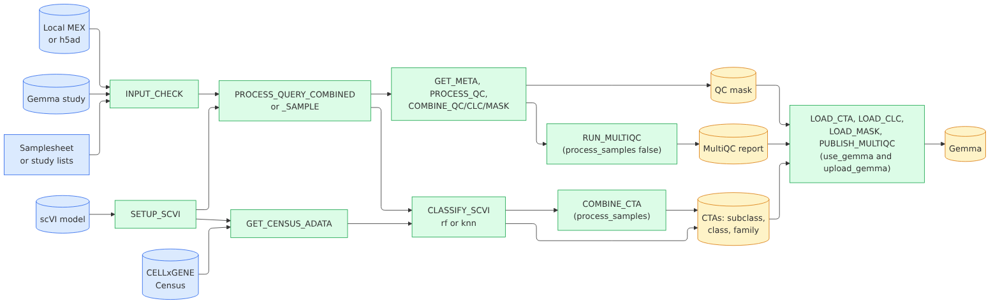

# Single-cell Re-annotation Pipeline for Human and Mouse Neocortex


## Abstract

This Nextflow pipeline annotates cell types in single-cell data from the [Gemma database](https://gemma.msl.ubc.ca) or from local files. We validated the input studies, downloaded the scVI model and reference cells from the CELLxGENE Census<sup>1</sup><sup>2</sup><sup>3</sup>, embedded each query study with scVI, and labelled every cell at subclass, class and family level with a random forest (default) or kNN classifier trained on the reference embeddings. We then computed QC metrics and an outlier mask and wrote a MultiQC report per study. Cell type assignments, QC outputs and the report can optionally be uploaded to Gemma.




*Figure 1. Pipeline data flow (version 2.1.2). Blue boxes are inputs, green boxes are steps, amber boxes are outputs; arrows show data flow.*

## Table of Contents

- [Requirements](#requirements)
- [Installation](#installation)
- [Quick Start](#quick-start)
- [Usage](#usage)
- [Parameters](#parameters)
- [Output](#output)
- [QC and Outlier Detection](#qc-and-outlier-detection)
- [References](#references)

---

## Test Profiles

A full human/mouse test profile matrix is provided:

| Profile | Organism | Notes |
|---------|----------|-------|
| `test_mouse` | mouse | Samplesheet-driven, default combined processing |
| `test_human` | human | Samplesheet-driven, default combined processing |
| `test_mouse_persample` | mouse | `--process_samples true` |
| `test_human_persample` | human | `--process_samples true` |
| `test_mouse_local` | mouse | `--study_paths` (MEX sample directory), `--use_gemma false` |
| `test_human_local` | human | `--study_paths` (single `.h5ad`), `--use_gemma false` |
| `test_mouse_upload_off` | mouse | `--upload_gemma false` |
| `test_human_upload_off` | human | `--upload_gemma false` |

Use with e.g. `-profile test_mouse,conda`. Run all of them and get a pass/fail summary with `scripts/run_test_profiles.sh`. The pipeline has no continuous integration; the eight test profiles, run with this script, are the tests.

## Requirements

- **Nextflow** >= 23.04.0
- **Conda/Mamba** or **Singularity/Docker** for environment management

---

## Installation

Nextflow can run the pipeline directly from GitHub, with no clone or checkout (see [Quick Start](#quick-start)). Cloning is needed only for development or to edit the pipeline files. The default branch (`main`) is kept at the latest release. To pin a version, add `-r` with a release tag (for example `-r v2.1.2`).

The stable release is also installed on the Pavlidis lab file system in:

```
/space/grp/Pipelines/sc-annotation-pipeline
```

For development:

```bash
git clone https://github.com/PavlidisLab/sc-annotation-pipeline.git
cd sc-annotation-pipeline
```

---

## Quick Start

Run directly from GitHub without cloning (add `-r <release tag>`, for example `-r v2.1.2`, to pin a version):

```bash
nextflow run PavlidisLab/sc-annotation-pipeline -r v2.1.2 -profile conda \
    --input /full/path/to/samplesheet.csv --organism mus_musculus
```

Run from a clone (the examples below use `main.nf` from the repository directory):

```bash
# Using a samplesheet (recommended)
nextflow run main.nf -profile conda -params-file params.mm.json \
    --input samplesheet.csv

# Mouse studies (from study names)
nextflow run main.nf -profile conda -params-file params.mm.json \
    --study_names "GSE154208 GSE123456"

# Human studies (from paths)
nextflow run main.nf -profile conda -params-file params.hs.json \
    --study_paths "/path/to/study1 /path/to/study2"

# Run with human test profile
nextflow run main.nf -profile test_human,conda

# Run with mouse test profile
nextflow run main.nf -profile test_mouse,conda
```

---

## Usage

### Input Options

The pipeline supports three input methods:

1. **Samplesheet** (`--input`) - Recommended, most flexible
2. **Study names** (`--study_names`) - Download from Gemma by name
3. **Study paths** (`--study_paths`) - Use pre-downloaded local data

#### Using a Samplesheet (Recommended)

A samplesheet is a CSV file that allows you to mix studies to download and local paths in a single run.

**Format:**

```csv
sample,study_name,study_path
GSE154208,GSE154208,
GSE123456,GSE123456,
local_study,,/path/to/local/data
```

| Column | Required | Description |
|--------|----------|-------------|
| `sample` | Yes | Unique sample identifier |
| `study_name` | No* | Study name to download from Gemma |
| `study_path` | No* | Path to pre-downloaded MEX data, or a single pre-combined `.h5ad` file |

*At least one of `study_name` or `study_path` must be provided per row.

**Example usage:**

```bash
nextflow run main.nf -profile conda -params-file params.mm.json --input assets/samplesheet.csv
```

An example samplesheet is provided at `assets/samplesheet.csv`.

#### From Study Names (Legacy)

Download studies directly from Gemma by name:

```bash
# Space-separated list
nextflow run main.nf -profile conda -params-file params.mm.json \
    --study_names "experiment1 experiment2"

# Text file (one study per line)
nextflow run main.nf -profile conda -params-file params.mm.json \
    --study_names studies.txt
```

#### From Study Paths (Legacy)

Use pre-downloaded MEX data, without needing Gemma credentials:

```bash
# Space-separated list
nextflow run main.nf -profile conda -params-file params.mm.json \
    --study_paths "/data/gemma/experiment1 /data/gemma/experiment2"

# Text file (one path per line)
nextflow run main.nf -profile conda -params-file params.mm.json \
    --study_paths paths.txt
```

Each path can be either a directory of per-sample MEX subdirectories, or a single pre-combined `.h5ad` file. A directory containing more than one `.h5ad` file is not supported — the pipeline only accepts one `.h5ad` per study.

**Required `.h5ad` format:**
- `X`: raw counts (cells x genes)
- `var_names` (index): Ensembl gene IDs — required for matching against the scVI reference
- `var['feature_name']` (optional): gene symbol per gene. If present, used directly for QC (mito/ribo/hb detection). If absent, symbols are looked up from `var_names` via `assets/gemma_genes.tsv`
- `obs['sample_id']` (optional): defaults to the samplesheet `sample` value if missing (treats the whole file as one sample)

This matches the shape of a Gemma-exported `.h5ad` (e.g. from `get_gemma_data.nf`). A `.h5ad` from a different source (e.g. counts in `layers['counts']` instead of `X`, or non-Ensembl `var_names`) is not currently supported without preprocessing it into this shape first.

### Profiles

| Profile | Description |
|---------|-------------|
| `conda` | Use Conda for environment management |
| `docker` | Use Docker containers |
| `singularity` | Use Singularity containers |
| `apptainer` | Use Apptainer containers |
| `test_human` / `test_mouse` | Samplesheet-driven test data |
| `test_human_persample` / `test_mouse_persample` | Test data with `--process_samples true` |
| `test_human_local` / `test_mouse_local` | Test data via `--study_paths`, `--use_gemma false` |
| `test_human_upload_off` / `test_mouse_upload_off` | Test data with `--upload_gemma false` |

SLURM execution is enabled by default and does not require a separate profile.

Note: `singularity`/`apptainer` must be installed on every node SLURM dispatches jobs to, not just the login node, or jobs fail with `singularity: command not found`. Use `-profile conda` on such clusters, or `-process.executor local` to run containers on the login node directly.

### Resuming Pipelines

```bash
nextflow run main.nf -profile conda -resume -params-file params.mm.json
```

### Working Directory

Specify a custom work directory to keep intermediate files organized:

```bash
nextflow run main.nf -profile conda -work-dir /scratch/my_workdir ...
```

---

## Parameters

### Input/Output

| Parameter | Description | Default |
|-----------|-------------|---------|
| `--input` | Samplesheet CSV file (recommended) | `null` |
| `--study_names` | Study names (space-separated or file, legacy) | `null` |
| `--study_paths` | Study paths (space-separated or file, legacy) | `null` |
| `--outdir` | Output directory | Auto-generated with timestamp |
| `--publish_dir_mode` | Method for publishing files | `copy` |

### Reference Options

| Parameter | Description | Default |
|-----------|-------------|---------|
| `--organism` | Species (`mus_musculus` or `homo_sapiens`) | `mus_musculus` |
| `--census_version` | CellxGene Census version | `2024-07-01` |
| `--organ` | Organ to sample from Census | `brain` |
| `--subsample_ref` | Cells per cell type to subsample | `500` |
| `--ref_collections` | Reference collection names (list). The mouse default in `nextflow.config` is the two collections used in `params.mm.json` (Tabula Muris Senis is no longer included); the human collections are in `params.hs.json` | Mouse collections |
| `--ref_tag` | Short reference tag used in the CTA protocol; `null` uses the first 6 hex characters of the SHA-256 of the sorted `ref_collections` | `null` |
| `--ref_keys` | Reference annotation keys | `["subclass_cell_type", "class_cell_type", "family_cell_type"]` |

### Classification Options

| Parameter | Description | Default |
|-----------|-------------|---------|
| `--classifier` | Classifier on scVI embeddings: `rf` (random forest) or `knn` (e.g. `--classifier knn`), both run in the `CLASSIFY_SCVI` process (`params.mm.json` sets `knn`) | `rf` |
| `--cutoff` | Min probability to assign label (configurable) | `0` |
| `--seed` | Random seed | `42` |
| `--process_samples` | Process samples individually | `false` |
| `--preferredCtaLevel` | Preferred annotation level | `class` |

### QC Options

| Parameter | Description | Default |
|-----------|-------------|---------|
| `--nmads` | MADs for outlier detection (map with per-metric thresholds) | `[mito: 20, umi: 5, genes: 5, counts: 5]` |

The `nmads` parameter accepts a map with separate thresholds for each QC metric:
- `mito`: Mitochondrial content outliers
- `umi`: UMI count outliers
- `genes`: Gene count outliers
- `counts`: Counts relationship outliers (genes vs UMI linear model)

Override specific metrics on the command line:
```bash
nextflow run main.nf --nmads.mito 3 --nmads.counts 4
```

### Asset Files

| Parameter | Description |
|-----------|-------------|
| `--rename_file` | Cell type renaming/selection file |
| `--markers_file` | Marker genes for QC plotting |
| `--gene_mapping` | NCBI to ENSEMBL/HGNC mapping |
| `--multiqc_config` | MultiQC configuration |
| `--original_celltype_columns` | Original cell type column mapping |
| `--author_annotations_path` | Author-provided annotations directory |

### Gemma Options

| Parameter | Description | Default |
|-----------|-------------|---------|
| `--use_staging` | Use Gemma staging server | `true` |
| `--use_gemma` | Top-level switch — set `false` to skip all Gemma interaction (per-sample metadata fetch during QC and uploads). Needed for studies from `--study_paths`/local samplesheet rows that don't exist in Gemma | `true` |
| `--upload_gemma` | Nested under `--use_gemma` — set `false` to skip only the upload subworkflow (still fetches metadata) | `true` |
| `--upload_cta` | Upload cell type annotations | `true` |
| `--upload_clc` | Upload cell-level characteristics | `true` |
| `--upload_mask` | Upload outlier mask | `true` |
| `--upload_multiqc` | Upload MultiQC report | `true` |
| `--cta_protocol` | CTA protocol identifier override; `null` builds it from the configuration (see Cell Type Assignment Protocols) | `null` |

#### Cell Type Assignment Protocols

The ctaProtocol is built as `sc-pipeline-<version>-<classifier>-census<census>-ref<tag>-n<subsample_ref>-cutoff<cutoff>`, e.g. `sc-pipeline-2.1.2-rf-census20240701-ref1710b1-n500-cutoff0`. The tag is `--ref_tag` or the first six hex characters of the SHA-256 of the sorted `ref_collections` (see `assets/ref_tags.tsv`). The ctaName is the protocol plus the level, e.g. `sc-pipeline-2.1.2-rf-census20240701-ref1710b1-n500-cutoff0-class`. Set `--cta_protocol` to override.

The pipeline creates the protocol in Gemma before the upload (`gemma-cli addProtocol`, in `LOAD_CTA`), so no manual step is needed. The protocol description is one line that records the pipeline version, classifier, census version, reference collections, reference tag, `subsample_ref`, cutoff, the scVI normalization and embedding, and the repository URL; it is logged at launch. If the protocol already exists, the CLI exits with code 2 and the message `There is already a protocol object with this name`; the pipeline ignores that case only, and any other `addProtocol` error (credentials, connectivity) stops the process. The `addProtocol` output is kept in `message.txt`.

**Note:** Set the `GEMMA_USERNAME` and `GEMMA_PASSWORD` environment variables for Gemma uploads and for downloading studies by name. They are read from the environment only; they are not pipeline parameters and are never passed as command-line arguments, so they do not appear in command lines or work files. The `singularity` and `apptainer` profiles forward both variables into the containers by name (`envWhitelist`). The `GET_META` process runs on the launch host (`conf/modules.config`), so it also reads them from the environment of the Nextflow launch. If they are unset, export them or set `--use_gemma false`.

The query loaders (`bin/process_query.py` and `bin/process_query_samples.py`) remove cells with zero counts before QC and classification and log the number removed per sample. The Gemma metadata fetch (`bin/get_gemma_meta.py`) falls back to the dataset taxon when a platform has no taxon.

### Parameter Files

Pre-configured parameter files are provided:

- `params.mm.json` - Mouse (mus_musculus)
- `params.hs.json` - Human (homo_sapiens)

Parameter priority: CLI arguments > params.json > nextflow.config

---

## Output

```
results/
└── mus_musculus_subsample_ref_500_2025-01-15_17-51-37/
    ├── scvi_model/                     # Downloaded scVI model
    ├── reference/                      # Census reference embeddings
    ├── <study_name>/
    │   ├── processed/                  # scVI query embeddings
    │   ├── predicted_celltypes/         # Cell type predictions
    │   ├── masks/                      # QC outlier masks
    │   ├── qc/                         # Per-sample QC output
    │   └── combined_qc/                # Combined QC output
    ├── multiqc/                        # Only when process_samples is false
    │   └── <study_name>/
    │       └── multiqc_report.html     # QC summary report
    └── pipeline_info/
        ├── execution_report.html       # Nextflow execution report
        ├── execution_timeline.html     # Timeline visualization
        ├── execution_trace.txt         # Resource usage trace
        └── pipeline_dag.dot            # Pipeline DAG
```

---

## QC and Outlier Detection

### MultiQC Report

A custom MultiQC report is generated by `process_QC.py` for each experiment, only when `--process_samples` is `false`. Outliers are defined using Median Absolute Deviations (MAD) per-sample following <a href="https://www.sc-best-practices.org/preprocessing_visualization/quality_control.html">best practices</a><sup>4</sup>.

### Outlier Metrics

Cells are marked as outliers if:

$$
\lvert M_i - \mathrm{median}(M) \rvert > X \cdot \mathrm{MAD}(M)
$$

where $X$ is the NMAD threshold for that metric (configurable via `--nmads`) and $M_i$ is one of:

| Metric | scanpy field | nmads key | Default |
|--------|--------------|-----------|---------|
| Mitochondrial | `pct_counts_mito` | `mito` | 20 |
| Gene content | `log1p_n_genes_by_counts` | `genes` | 5 |
| UMI content | `log1p_total_counts` | `umi` | 5 |

**Note on mitochondrial threshold:** The default `mito` threshold is set higher (20 MADs) than other metrics because certain cell types (e.g., astrocytes)  exhibit higher mitochondrial gene expression. A stricter threshold can lead to disproportionate false-positive outlier calls for these cell types.

### Counts Outliers

"Counts" outliers are cells whose gene counts deviate from the expected log-linear relationship with UMI counts:

$$
r_i = \ln(\mathrm{genes}_i + 1) - \widehat{\ln(\mathrm{genes}_i + 1)}
$$

where fitted values come from: $\ln(\mathrm{genes}+1) \sim \ln(\mathrm{counts}+1)$

Outliers: $\lvert r_i - \mathrm{median}(r) \rvert > X \cdot \mathrm{MAD}(r)$

The threshold $X$ is controlled by `--nmads.counts` (default: 5).

### Doublet Detection

Doublets are predicted using the <a href="https://scanpy.readthedocs.io/en/stable/api/generated/scanpy.pp.scrublet.html">Scanpy implementation of Scrublet</a> <sup>Wolock et al., 2019</sup>.

---

## References

1. Lim N., et al., Curation of over 10,000 transcriptomic studies to enable data reuse. Database, 2021.
2. CZI Single-Cell Biology Program, et al. "CZ CELL×GENE Discover: A Single-Cell Data Platform for Scalable Exploration, Analysis and Modeling of Aggregated Data," November 2, 2023. https://doi.org/10.1101/2023.10.30.563174.
3. Lopez, Romain, et al. "Deep Generative Modeling for Single-Cell Transcriptomics." Nature Methods 15, no. 12 (December 2018): 1053–58. https://doi.org/10.1038/s41592-018-0229-2.
4. Heumos, L., Schaar, A.C., Lance, C. et al. Best practices for single-cell analysis across modalities. Nat Rev Genet (2023). https://doi.org/10.1038/s41576-023-00586-w
